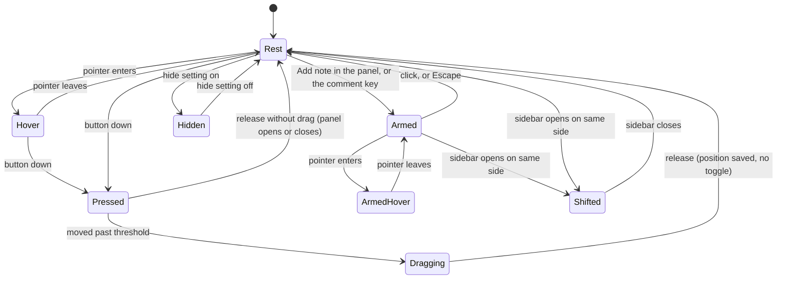
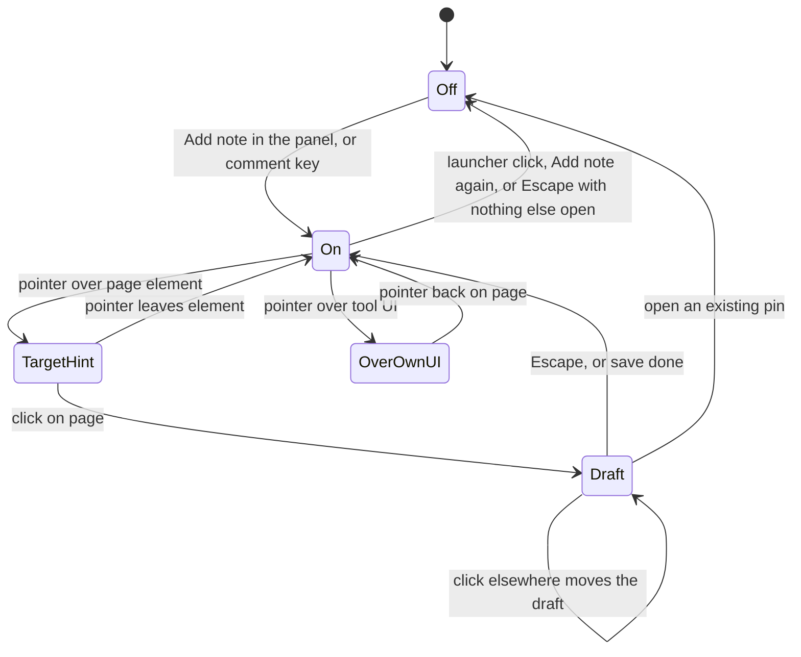
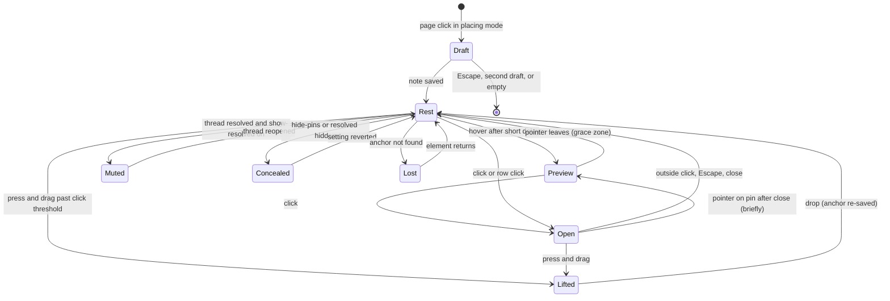
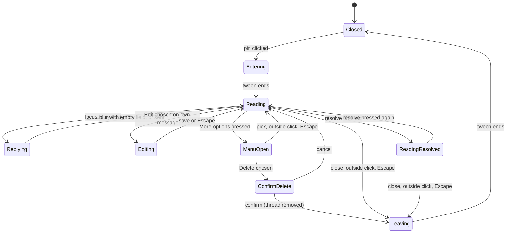
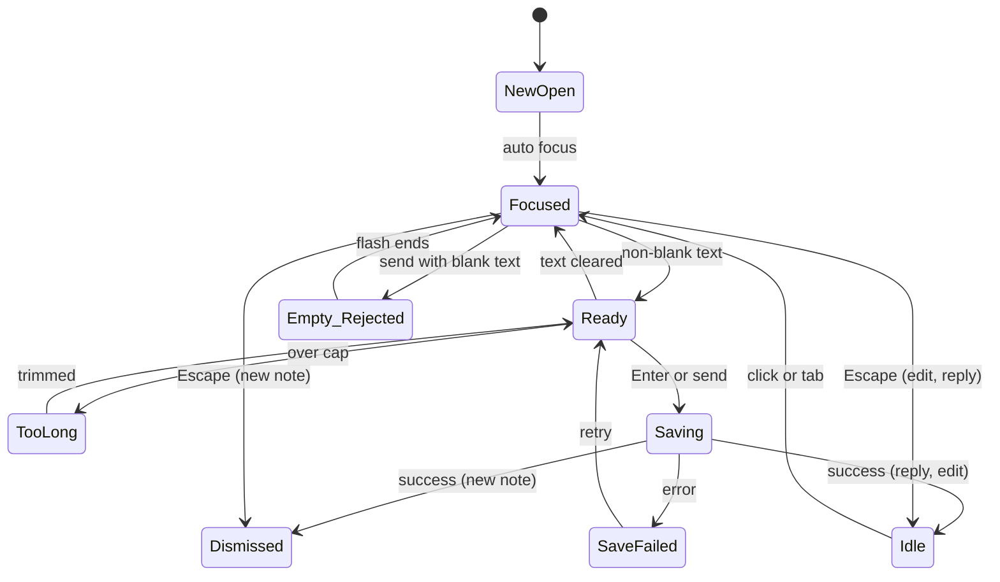
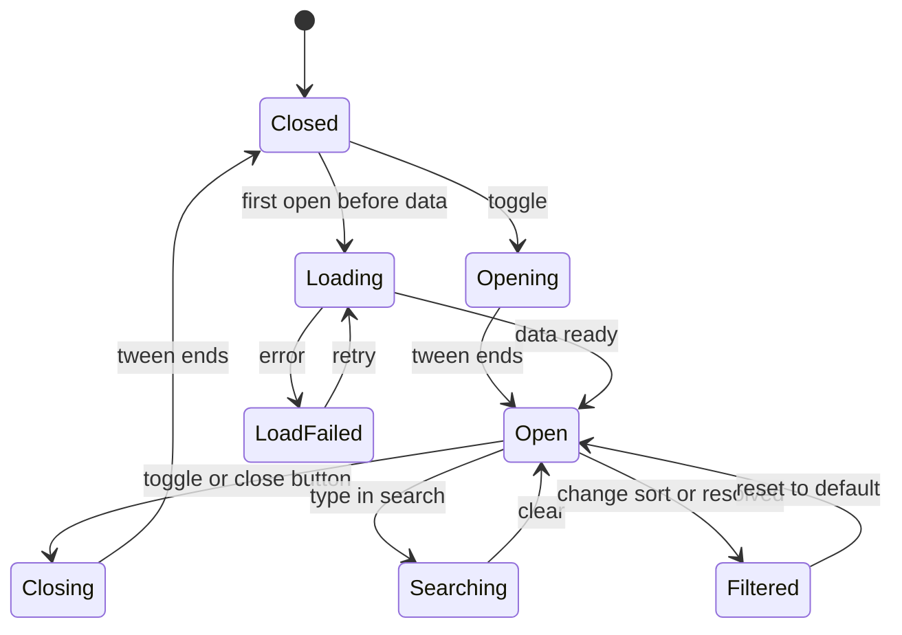
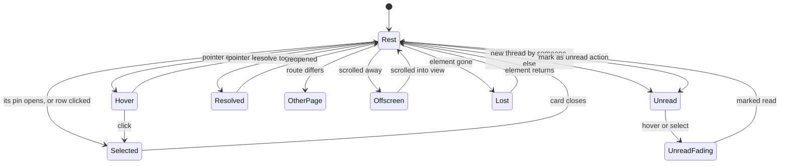
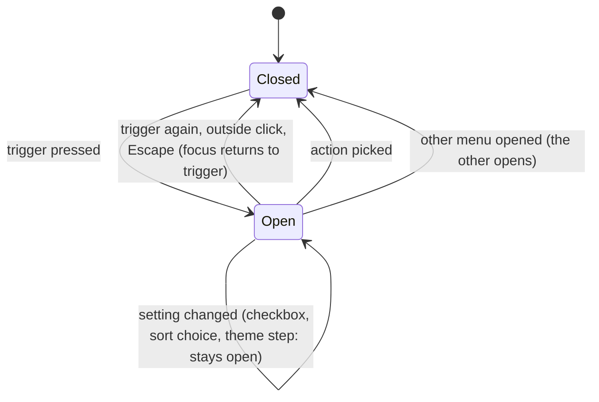
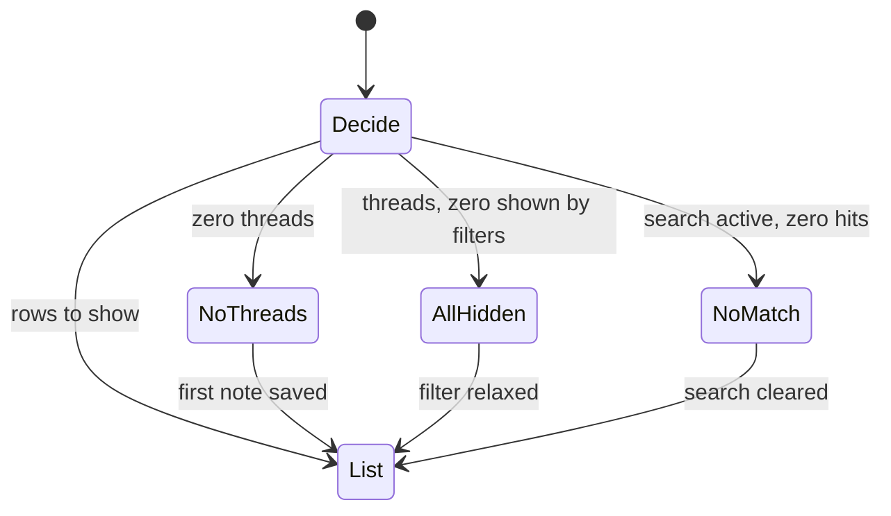

# Glossary: every UI state and transition, per surface

This file gives each state **one stable name** so an implementer can refer to it in code, tests and cards. Names take the form `SURFACE.State`. This file holds names, meanings and transitions only. How a state looks and moves is in `DESIGN.md` section 3, and nowhere else.

Coverage tags say when a state was first written down: **B** (its behaviour) and **V** (its look) in the working notes this glossary replaced, **new** here.

## Surface index

| # | Surface | Prefix |
| --- | --- | --- |
| 1 | Launcher | `LAUNCHER` |
| 2 | Placing mode (page-wide) | `PLACING` |
| 3 | Pin (three-stage marker) | `PIN` |
| 4 | Thread card | `CARD` |
| 5 | Composer (new note, reply, edit) | `COMPOSER` |
| 6 | Sidebar panel | `SIDEBAR` |
| 7 | Sidebar row | `ROW` |
| 8 | Filter menu and More menu | `MENU` |
| 9 | Empty and error states | `EMPTY` |

---

## 1. Launcher (`LAUNCHER`)

| State | Meaning | Cov. |
| --- | --- | --- |
| `LAUNCHER.Rest` | Idle, the tool's one button on the host page; a click opens or closes the panel | B V |
| `LAUNCHER.Hover` | Pointer over it, placing off | V |
| `LAUNCHER.Pressed` | Button down, not yet moved | V |
| `LAUNCHER.Armed` | A note is being placed; the button is now the way out, and a click stops placing | B V |
| `LAUNCHER.ArmedHover` | Armed and hovered | new |
| `LAUNCHER.Dragging` | Moved past the drag threshold | B V |
| `LAUNCHER.Shifted` | Sidebar opened on its side; parked clear of the panel | B V |
| `LAUNCHER.Hidden` | Hidden by setting; shortcut still works | B V |
| `LAUNCHER.Focus` | Keyboard focus (our addition) | V gap |

| Trigger | Change |
| --- | --- |
| Pointer enter / leave | Lifts, then settles |
| Press | Settles under the pointer |
| Drag past threshold | Tweens off, follows pointer, clamped inside viewport |
| Release after drag | Stays where dropped, tweens back on, position stored |
| Release after click | At rest, opens or closes the panel. While a note is being placed, stops placing and leaves the panel as it was |
| Sidebar open or close | Slides by panel width, only on matching side |

---

## 2. Placing mode (`PLACING`)

Page-wide state, shown through the cursor and the wash on a target rather than a surface of its own.

| State | Meaning | Visual signal | Cov. |
| --- | --- | --- | --- |
| `PLACING.Off` | Normal browsing | Normal cursor, page untouched | B |
| `PLACING.On` | Clicks drop pins | Drop-pin cursor over host page; `LAUNCHER.Armed` | B V |
| `PLACING.TargetHint` | Pointer over a page element while On | A highlighter wash laid over that element, in the tool's own layer; the element itself is never touched | V new |
| `PLACING.WideTarget` | Pointer over an element that fills three tenths of the view or more | No wash (it has thinned to nothing on the way there): a note there is pinned to the spot, and the cursor already shows it | new |
| `PLACING.Selecting` | Words are being dragged over while placing: the selected words alone are marked, in the highlighter, and the wash on the element is gone | new |
| `PLACING.OverOwnUI` | Pointer over launcher, sidebar, pins or cards while On | Normal cursor, no wash, clicks do not drop | B |
| `PLACING.Draft` | A click was made; draft pin plus `COMPOSER.NewOpen` exist | Draft pin at click spot (`PIN.Draft`) | B |
| `PLACING.Moving` | "Move pin" was chosen in a note's menu: the next spot chosen (a click, or Enter on a focused element) becomes that note's place; Escape leaves it where it was | Drop-pin cursor; the note's pin wears `PIN.Lifted`; the note is shut | new |

| Trigger | Change |
| --- | --- |
| Comment key / Add note in the panel | Cursor swaps, launcher goes Armed |
| Pointer moves over page elements | The wash travels from element to element, and goes away over one that fills the view |
| Page click | Click effect on host page suppressed; draft pin appears |
| Escape | Closes most specific thing first |

Reduced motion: no animated cursor effects.

---

## 3. Pin (`PIN`)

A pin is one object that grows through three stages in place.

| State | Meaning | Cov. |
| --- | --- | --- |
| `PIN.Draft` | Placed, note not saved | B |
| `PIN.Rest` | Saved, avatar tab | V |
| `PIN.RestUnread` | Rest, not yet seen by this person | new |
| `PIN.Preview` | Hover card grown from the pin | V |
| `PIN.Open` | Its note is open, whether from the pin or from its row; the pin is the open note's face | V |
| `PIN.Lifted` | Being dragged | B V |
| `PIN.Muted` | Resolved but shown | B V |
| `PIN.Lost` | Target element missing, or with no box on the page (display: none); not drawn, the row says why | B V |
| `PIN.OutOfSight` | Target on the page but out of sight (hidden, transparent, clipped away, or covered at the pin's spot); not drawn, and the row is an ordinary one. Opening the note from its row draws the pin on its spot anyway, and the card opens from it | new |
| `PIN.Offstage` | Target scrolled out of view | B |
| `PIN.Concealed` | All pins hidden by setting, or resolved and show-resolved off | B V |
| `PIN.Pointed` | Its list row is under the pointer | new |
| `PIN.Quoted` | The note is anchored to selected words | new |

| Trigger | Change |
| --- | --- |
| Hover on pin, held past a short delay | Preview opens from the pin |
| Pointer leaves pin and preview | Collapses after a grace delay; padding zone prevents flicker |
| Click | The same shell grows from preview to thread; the pin becomes the note's face |
| Mark as read | Unread dot fades when the card opens (not on hover) |
| Drag | Lift, follow pointer, settle on drop |
| Resolve toggle | Pin dims or hides according to show-resolved |

---

## 4. Thread card (`CARD`)

| State | Meaning | Cov. |
| --- | --- | --- |
| `CARD.Closed` | Not on screen | B |
| `CARD.Entering` | Arriving: growing out of its pin, or rising as a phone sheet, or fading in as the missing-pin dialog | V |
| `CARD.Reading` | Steady state, unresolved | V |
| `CARD.ReadingResolved` | Steady, thread resolved | V |
| `CARD.Replying` | Reply field focused | V |
| `CARD.Editing` | One own message swapped for an inline field | V |
| `CARD.MenuOpen` | More-options menu under header | B V |
| `CARD.ConfirmDelete` | Delete asked for; waiting for yes or no | B new |
| `CARD.Leaving` | Reverse of Entering | V |
| `CARD.Overflowing` | Many replies; body scrolls | V |
| `CARD.Repositioning` | Page scroll or resize moves the anchor | B |
| `CARD.Walked` | Opened with the next / previous key | new |
| `CARD.UndoOffered` | A note was just resolved | new |
| `CARD.Sheet` | Viewport too narrow for a card beside the pin | new |
| `CARD.Adrift` | The note is on this page but its pin has nowhere to be (target missing or hidden); it opens as a centred modal dialog with one line saying why; the panel and launcher wait behind it | new |

| Trigger | Change |
| --- | --- |
| Open | Grows out of the pin; thread marked read |
| Close / outside click / Escape | Reverse |
| Resolve toggle | The button's word changes from Resolve to Reopen; Muted pin and row follow |
| Edit | Text swaps for field, focus placed at end |
| Send reply | Reply appears at bottom, field clears, body scrolls to it |
| Icon button hover | Faint wash |

---

## 5. Composer (`COMPOSER`)

One field-plus-send pattern, three placements.

| State | Meaning | Cov. |
| --- | --- | --- |
| `COMPOSER.NewOpen` | Floating bar beside draft pin, empty | B V |
| `COMPOSER.Idle` | Field unfocused (reply or edit) | V |
| `COMPOSER.Focused` | Caret in field | V |
| `COMPOSER.Ready` | Non-blank text, send enabled | B V |
| `COMPOSER.SendHover` | Pointer on enabled send | V |
| `COMPOSER.Empty-Rejected` | Save attempted with nothing | B |
| `COMPOSER.TooLong` | At or over length cap | V |
| `COMPOSER.Saving` | Write in flight | new |
| `COMPOSER.SaveFailed` | Write failed | B new |
| `COMPOSER.Dismissed` | Escape or draft replaced | B |

| Trigger | Change |
| --- | --- |
| Focus | Border and halo come in |
| Typing first non-blank character | Send becomes enabled |
| Enter | Sends; Shift+Enter adds a line |
| Blank send | Warning flash on border |
| Success | Bar closes or reply row appears |

---

## 6. Sidebar panel (`SIDEBAR`)

| State | Meaning | Cov. |
| --- | --- | --- |
| `SIDEBAR.Closed` | Off-screen | B |
| `SIDEBAR.Opening` | Sliding in | V |
| `SIDEBAR.Open` | Docked | B V |
| `SIDEBAR.Closing` | Sliding out; launcher returns | B |
| `SIDEBAR.OpenLeft` / `SIDEBAR.OpenRight` | Docking side (setting) | B V |
| `SIDEBAR.Searching` | Text in search field | V |
| `SIDEBAR.Filtered` | Sort or show-resolved differs from default | new |
| `SIDEBAR.Alias` | The host page has not said who this person is (whatever the store): they write under a made-up name until they give their own, and the foot of the panel says which ("Critting as …") and offers a pencil to use their own | new |
| `SIDEBAR.Naming` | That foot with a name field and a tick in place of the words and the pencil; Enter saves, Escape goes back | new |
| `SIDEBAR.ReadOnly` | The store says this visitor may only read: no Add note, no reply row, no Resolve, pins do not drag, and the foot of the panel says so | new |
| `SIDEBAR.Loading` | Initial load of threads | new |
| `SIDEBAR.LoadFailed` | Load failed | new |

| Trigger | Change |
| --- | --- |
| Toggle | Slides from docked edge; the page is padded aside so nothing sits under the panel; launcher steps aside |
| Type in search | List narrows live; counts in headings update; clear button appears |
| Dock side switch | Panel jumps to other edge, closed then reopened |
| Scroll area hover | Slim scrollbar fades in |

---

## 7. Sidebar row (`ROW`)

| State | Meaning | Cov. |
| --- | --- | --- |
| `ROW.Rest` | Idle chip | V |
| `ROW.Hover` | Pointer over | V |
| `ROW.Selected` | Its thread is open on the page | B V |
| `ROW.Unread` | Not read by this person | B V |
| `ROW.UnreadFading` | Hovered or selected while unread | V |
| `ROW.Resolved` | Resolved, listed because show-resolved on | B V |
| `ROW.OtherPage` | Thread belongs to another route | B V |
| `ROW.Offscreen` | Same page, target out of view; says so, not muted | B V |
| `ROW.Lost` | Target missing on the page; click opens the note as a dialog (`CARD.Adrift`). A target that is only out of sight (`PIN.OutOfSight`) gets an ordinary row, with no reason line | B new |
| `ROW.Pointed` | Its pin is under the pointer | new |
| `ROW.Resolving` | Resolve in flight | new |
| `ROW.Focus` | Keyboard focus (our addition) | V gap |
| `ROW.Entering` / `ROW.Leaving` | List add or remove (new note, delete, filter change) | new |

Tags such as Unread, Resolved and OtherPage are **independent flags**: a row can be Unread and OtherPage together. The look is the layered sum (dot plus mute), with Selected winning over Hover.

| Trigger | Change |
| --- | --- |
| Hover | Wash fills in |
| Click, same page and visible | Page scrolls pin into view if needed, card opens, row Selected, read mark applied |
| Click, other page or off-screen | Navigates or scrolls, then opens |
| Resolve toggle | Row dims or leaves list per setting |
| Mark as unread | Dot appears again |
| New thread arrives | Row slides in at its sorted place |

---

## 8. Menus (`MENU`)

Two menus (Filter and More) share one pattern.

| State | Meaning | Cov. |
| --- | --- | --- |
| `MENU.Closed` | Not shown | V |
| `MENU.Open` | Dropdown under trigger, trailing edges aligned | V |
| `MENU.ItemRest` | Entry idle | V |
| `MENU.ItemHover` | Pointer or arrow-key focus | V |
| `MENU.ItemActiveChoice` | Current radio choice | V |
| `MENU.ItemChecked` | Checkbox on | V |
| `MENU.ItemDisabled` | Not available now | V |
| `MENU.Theme` | One row in the More menu that steps the theme: Light, Dark, Match system; the menu stays open | new |
| `MENU.ShareLink` | "Copy link to share" leads the More menu, when the store has a link | new |
| `MENU.ShareCopied` | That item just after it was used | new |
| `MENU.Shortcuts` | "Keyboard shortcuts" in the More menu, a checkbox, on by default: off, the single-letter keys (add, next, previous, and Shift with add) do nothing. Escape, Enter and Tab are not letters and stay | new |

| Trigger | Change |
| --- | --- |
| Open | Drops in under trigger |
| Item hover | Wash |
| Pick sort | List reorders; menu closes |
| Toggle hide pins or hide launcher | Takes effect at once on page |

---

## 9. Empty and error states (`EMPTY`)

| State | Meaning | Cov. |
| --- | --- | --- |
| `EMPTY.NoThreads` | No threads anywhere | V |
| `EMPTY.NoThreadsShare` | No threads anywhere, and the store has a link to send people | new |
| `EMPTY.AllHidden` | Threads exist, filters or resolved hide all | V |
| `EMPTY.NoMatch` | Search found nothing | V |
| `EMPTY.SectionOmitted` | A section has zero rows | V |
| `EMPTY.NoPageThreads` | Nothing on this page | V |
| `EMPTY.NoteBlank` | Blank send attempted | B |
| `EMPTY.StorageFailed` | Save or load failed | new |

All empty states are replaced instantly (fast cross-fade at most) as the list content changes. Pair every colour-only cue with a glyph or text.

---

## 10. Cross-surface transitions (what one change does to the others)

| Event | Launcher | Pin | Card | Sidebar and rows |
| --- | --- | --- | --- | --- |
| Click launcher | unchanged (or Armed to Rest, if placing) | none | none | Opens or closes |
| Click Add note | Rest to Armed | none | none | Stays open (closes on a phone) |
| Page click while Armed | Armed | Draft appears | Composer bar opens | none |
| Save new note | Armed | Draft to Rest | Composer dismissed | Row enters |
| Click pin | unchanged | Rest to Open | Entering | Row Selected, dot fades |
| Click row | unchanged | Opens pin after scroll | Entering | Row Selected |
| Escape | Armed to Rest only when nothing else open | Open to Rest | Leaving | Selected cleared |
| Resolve | unchanged | Muted or Concealed | Resolved look | Resolved row, may leave list |
| Open sidebar | Shifted if same side | unchanged | Repositions clear of panel | Opening |
| Toggle hide pins | unchanged | All Concealed | Closes | Rows stay |
| Delete thread | unchanged | Pin removed | Leaving | Row Leaving |

## 11. Coverage notes for the builder

- **Described before, named here:** launcher, pin stages, card chrome, row look, menus, empty states; Escape ladder and draft rules.
- **First described here (new):** `PIN.RestUnread`, `LAUNCHER.ArmedHover`, `CARD.ConfirmDelete`, `COMPOSER.Saving` and `.SaveFailed`, `SIDEBAR.Loading`/`.LoadFailed`/`.Filtered`, `ROW.Lost`/`.Resolving`/`.Entering`/`.Leaving`, `EMPTY.StorageFailed`, `CARD.Adrift`, `MENU.ShareLink`/`.ShareCopied`, `EMPTY.NoThreadsShare`. These are our own design completions; keep them quiet and consistent with the roles above.
- **Gaps this design set out to close:** no light theme, weak keyboard focus, hint-grey contrast, colour-only cues.

---

## 12. Surface rules

Sections 1 to 9 name the states. This section says what kind of work each surface is for, and the rules that follow from it. Each rule carries its reason so it is not misapplied. The objects are in `PRODUCT-MODEL.md`; proven solutions are in `CANONICAL.md`. Drafted 2026-11-17; *(inferred)* marks a reason that could not be traced to a spec, PR or commit.

| Surface type | The work | Surfaces |
|---|---|---|
| On the page | Marking a spot, and seeing that spots are marked, without getting in the way of the host page | `LAUNCHER`, `PLACING`, `PIN`, the undo toast, the storage banner |
| Note card | Reading, writing and answering one note | `CARD`, `COMPOSER`, the preview (`PIN.Preview`) |
| Panel | Finding a note that is not in view, and working through many | `SIDEBAR`, `ROW`, `EMPTY` |
| Menu | Changing a setting, or a rare action | `MENU` |

### On the page
- **Editing**: none. These parts start things (place, open, undo); the writing happens in a note card. A pin is moved by dragging it, or by "Move pin" in its note's menu and then choosing the spot (`PLACING.Moving`), because where it sits is the one thing about a note that is edited on the page itself.
- **Density**: as little as will do the job. One launcher, one pin per note, at most one toast. The reader came for the page.
- **Primary action**: open the notes (the launcher). It is the tool's only button on the host page; adding a note starts in the panel or with the comment key.
- **Element roles allowed**: recognition marker (the face in a pin), status (unread dot, resolved check, muted), control (the launcher, Undo). The accent is allowed as a fill behind ink, and it means "this is the tool": a pin, the launcher at rest (which is the mark), the pointer while placing.
- **Never here**: text beyond a toast's one line; anything that follows the theme (brand rule 3); a second launcher button (Launcher card: one call to action on someone else's page; anything else belongs in the panel); scale or rotation on a pin, because it moves the point it marks; a dialog over the host page, except for a note that has no pin to open from (the maintainer, 2026-11-17).
- **Canonical examples**: One sharp corner, pointing at the anchor; What sits on the page does not theme; Resolve with a matching Undo.

### Note card
- **Editing**: in place. A reply is written at the foot of the card, an edit swaps the message for a field, and a delete is confirmed where the message was. Nothing opens a second layer, because the card is already floating over someone else's page.
- **Density**: comfortable, one column, one fixed width. It is read like a short conversation, not scanned like a table.
- **Primary action**: Send (the only accent-filled control in the card). Resolve is secondary and is a labelled button.
- **Element roles allowed**: content (the messages), recognition marker (faces; the quoted words as the title), status (resolved), control (Resolve, More, Close, Send). The sharp corner is structural: it says which pin the card belongs to.
- **Never here**: a second accent-filled control; a bare icon for Resolve (Icon card); nested replies; a card with no sharp corner while it has a pin to point at; a toast for an error.
- **Canonical examples**: Delete is confirmed inside the card; A failed save keeps the words; A note is titled by what it is pinned to; Escape backs out one level.

### Panel
- **Editing**: none, beyond the resolve toggle on a row. A row opens its note where the note lives; the panel never shows a thread itself, so a note has one presentation (the maintainer, 2026-11-17).
- **Density**: the densest surface. Rows are compact and uniform so that many can be scanned; the two sections are the only grouping.
- **Primary action**: open a note (the whole row).
- **Element roles allowed**: recognition marker (face), status (unread dot, resolved check, mute plus its reason line), control (search, filter, resolve toggle), content (first lines). Selection is the wash alone.
- **Never here**: a side stripe on a row (Row card); an empty section heading; a muted row without its reason; an accent fill in the list, because nothing there is "live" in the pin's sense *(inferred)*. The head's Add note is the panel's one filled control: it starts a note.
- **Canonical examples**: A muted row says why; Row and pin point at each other; An empty list offers the way out; A note on another page is opened there.

### Menu
- **Editing**: a setting takes effect as it is picked. A checkbox leaves the menu open; a choice or an action closes it.
- **Density**: a short list. If it needs scrolling it is holding too much.
- **Primary action**: none. Every item is equal, except that a destructive item goes last.
- **Element roles allowed**: control, and status for the current choice (dot plus wash) and a checked box.
- **Never here**: two menus open at once; an item hidden because it is unavailable (disable it and say why); anything that needs a field.
- **Canonical examples**: none yet.

### Motion
Motion answers something the reader did, or marks one thing that changed under them. If nothing happened, nothing moves. Timings and the curve come from the motion tokens in `crittable/pinwall.js` (`fast`, `medium`, `linger`, `instant`, `ease`); the literal exceptions are baselined in `smoke_test.py`.

| Job | Where | Token | Why |
|---|---|---|---|
| Answer a press or a hover | buttons, rows, pins lifting | `fast` | Says the control heard you; anything slower feels like lag |
| Unfold the thing you pointed at | pin to preview to thread, composer from the draft pin | `medium` × 0.8 (`--morph`) | One shell resizes with its sharp corner held on the anchor, so it reads as the same note opening, not a new part arriving |
| Bring in a layer you asked for | menus, the panel, the toast, a card with no pin to grow from | `medium` for travel, `fast` for a fade | Shows where it came from and that it sits above the page |
| Show what changed in a list | a row entering or leaving | `fast` | The reader keeps their place while the list changes round it |
| Show what the pointer is on | the wash on a target arriving, and travelling to the next target | `fast` | It answers the pointer reaching something new; it never loops, because nothing is waiting |
| Greet the pointer | the mark's eyes blinking once when the pointer reaches the launcher (`cm-blink`) | `mark-blink`, closing on `mark-shut` and opening on `mark-open` | The mark's own animation. The pills flatten straight down, rest shut for a beat and open again. Tried and dropped the same day: swapping to an arc, tweened or cut, single or double (read as flicker); bending the stroke into an arc; eyes that follow the pointer (too busy here). Once per arrival, never on a loop, and only the eyes change: the pin and its point stay put. On trial |
| Greet the pointer, in the panel | the panel's mark bobbing 2px and winking its right eye once when the pointer reaches the lockup (`cm-bob`, `cm-wink`) | `mark-nod` (.3s; .42s was "a touch slow"); the bob on `ease`, the wink on `mark-shut` and `mark-open` | "little bob and a wink on hover on this guy". A wink, not the launcher's blink, so the two marks do not do the same thing in step when both are in view. |
| Show the theme change | the theme row's sign setting while the next one rises (`cm-set`, `cm-rise`) | `medium`, `ease` | Answers a press, and says which way the step went: the sun goes down, the moon comes up. One sign at rest; never both. |
| Show the theme change, across the surface | every colour in the panel fading to the new theme (`.theming`) | `medium`, `ease` | A whole surface changing at once should not flash. The fade is switched on only for the step, so nothing else is slowed. |
| Turn the mark into the way out | the launcher's eyes sliding together, stretching and crossing while a note is placed | `medium`, `ease`; the fill `fast` | It is the same face in another look, so nothing is swapped. |
| Keep the launcher with the panel | the launcher sliding as the panel opens or shuts | `medium`, `ease`, the panel's own | It rides the panel's edge instead of jumping to its new place. No tween on a resize or a drag. |
| Confirm a placement | the draft pin dropping onto its spot (`cm-plant`) | `plant`, the one signature | The only flourish; it marks the moment a spot is chosen |
| Let a warning go | the blank-send border fading out | `linger` | The only slow fade, so the warning is not missed |
| Say "working" | loading rows, the send spinner | looping, literal | The only motion with no cause from the reader; it stands for a wait |
| Follow the pointer or the page | dragging a pin or the launcher, pins tracking scroll | `instant` | A tween on something being tracked reads as drag |

- One motion per action.
- The point of a pin never moves. Translate only; never scale or rotate a pin.
- Nothing disabled moves.
- No spring, no wobble, no glow (brand rule 4).
- Under `prefers-reduced-motion` keep the change and drop the travel: everything is instant.
- How a motion feels is the maintainer's call. Propose, do not rule.

### Cross-surface rules
- A note has one detail presentation, the thread card. The row and the preview are cut from it, not designed separately.
- The same kind of edit opens the same way everywhere: in place, inside the card.
- Colour, a container or an icon needs a role (recognition marker, status, control, structural container, content). Without one, cut it.
- A control and its confirmation use the same word (brand book, Words).
- Every colour cue is paired with a glyph or a word.

## 13. Known drift

Places where the specs, the brand book and the code disagree. Fix or settle each; do not copy either version. "Code" is `crittable/pinwall.js`. Settled on 2026-11-17 and removed from this list: the look columns in sections 1 to 9, the focus-ring wording, the red side stripes, the initials size and the 500 weight, the launcher corner radius, and the retired first demo.

- Motion: `cm-plant` runs for a literal .26s, the loading rows 1.2s, the spinner .7s, and the unread dot waits .4s. `DESIGN.md` section 4 allows only the named durations.
- The menu checkbox has a literal 4px radius; no radius token is that small.

Found by an independent review on 2026-11-17, not yet settled:
- Touch targets: the row's two toggles stay at 26px for a coarse pointer; icon buttons, Send and Resolve grow to 40px.

Settled from that review (2026-11-17): a row tap on a phone closes the panel; a failure in an open card is said in the card; spare anchors are never positional; menus close on a choice (changed 2026-11-23: a setting keeps the menu open, only an action closes it; see DECISIONS), return focus to their button, move with the arrow keys without choosing, and only one is open at a time; Escape backs out one level (closing a note no longer also leaves placing mode) and closes the panel when focus is in it; a blank send says "A note cannot be empty."; the filter button's label says when it is changed; a muted row keeps its reason line at full strength; the reply row is hidden while a note is edited, so the card has one filled button; Tab stays inside the missing-pin dialog.

## 14. Open questions

None waiting.

Settled questions, with the reasoning, are in `DECISIONS.md`.
